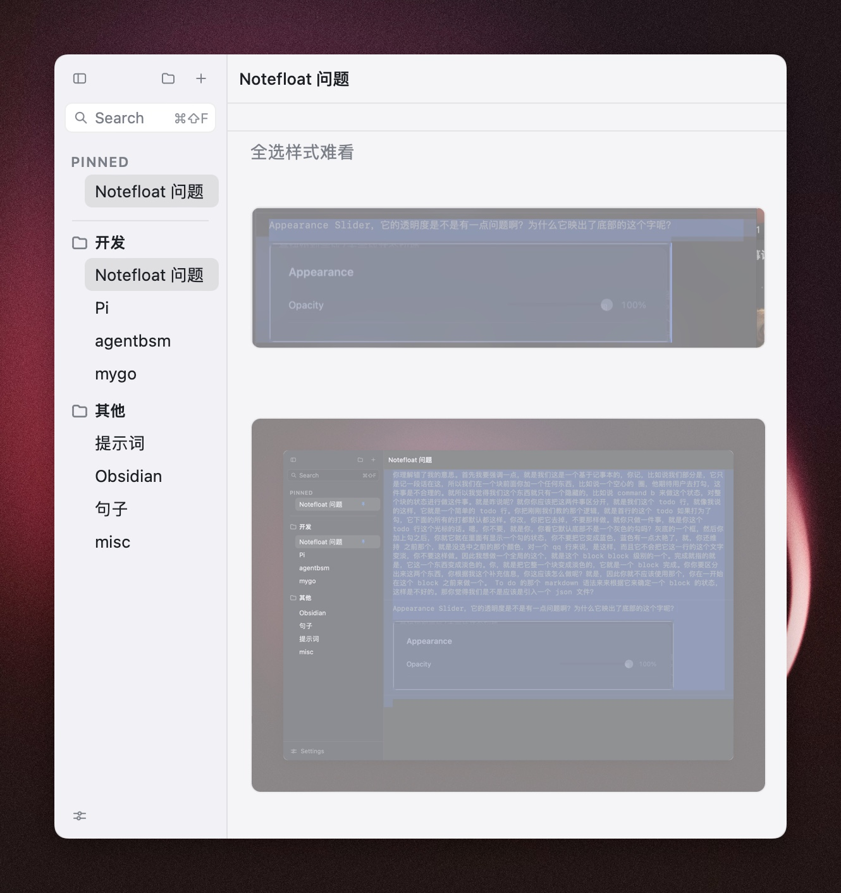

# Notefloat

A floating notes panel for macOS.
Press Option-V anywhere and the panel appears over whatever you are doing; press Option-V again and it is gone.
It holds text, todos and pasted pictures.



## Why it exists

While developing, I often run into a problem B in the middle of a requirement A and cannot deal with it right away, so it has to be written down. But creating a new text file every time, or typing a separator by hand inside one text file, feels slow.
So I use [heynote](https://github.com/heyman/heynote): its block idea is exactly what I was after. For a project I only need one text file, and I keep appending blocks to it, which forms a stack of todos on its own that I can work through in order.

But heynote has two pain points:
1. The global summon and hide shortcut is not responsive enough;
2. It cannot paste pictures. While developing I often meet bugs that need a small UI adjustment, and I do not always have time for them then, so I need to screenshot the UI, paste it, and later copy the whole picture to an agent to fix it.

## What it does

- **Summon and dismiss.** A global shortcut, Option-V by default, changeable in Settings.
- **Blocks.** One note holds several blocks, with a line of ∞∞∞ between two of them.
  - Command-Enter adds a block under the current one, Command-Shift-Enter adds one above it, and Option-Enter splits the current block at the caret.
  - Option-Up and Option-Down move a block, caret included; Command-Up and Command-Down step to the previous and the next block.
  - Command-A selects the block, and pressing it again selects the whole note.
  - Command-B toggles the block's done state, and a finished block turns grey as a whole.
  - Command-D folds the block the caret is in, and a second press unfolds it; Command-Shift-D folds the whole note, and unfolds all of it again. A folded block is drawn as a read-only reading view cut to the height the settings hold (4 rows by default, 1 to 12 at most), as many rows tall however the window is dragged, whatever number of text lines it holds; a gradient blur sits at its bottom, and a press unfolds it with the caret where the press was.
  - The funnel at the right of the titlebar switches between showing every block and showing only the blocks not marked done.
- **Todos.**
  - Command-L turns the line under the caret into a todo, and pressing it again turns it back into plain text.
  - Command-Shift-L toggles that todo line's done state.
- **Pictures.**
  - Paste a picture anywhere in a note and it is stored for you.
  - You can copy the picture's path to hand to an agent.
- **Folders and pinned notes.**
  - Notes and folders both move by dragging.
  - The sidebar's right edge drags to another width.
- **Plain text.** Every note is a `.txt` file, its blocks separated by a line of `∞∞∞`.
  - A picture is a text line holding its relative path.
  - A block's done mark and fold mark ride on that separator line as well (`∞∞∞|done`, `∞∞∞|folded`), so a mark travels with its block: moving, splitting, deleting, undoing, or editing the note in another editor all leave it on the block it belongs to.
- **Local only.**
  - No account, no sync, no network.
  - Data lives in `~/Library/Application Support/Notefloat/` by default, and can be moved to another directory you choose.
  - Pictures are stored as `images/<sha256>.<ext>`, relative to the data directory.
- **Keyboard first.**
  - Command-N new note, Command-Shift-N new folder, Command-P pin, Command-S sidebar, Command-comma settings.
  - Command-F finds inside the current note, Command-Shift-F searches every note.
  - Every shortcut can be customized.
- **Tidy by itself.** A daily sweep moves pictures that no note has referred to for seven days to the Trash.

Settings hold the shortcuts, the panel opacity, the fold height, the data directory and whether the app opens at login.

## Development

macOS 12.0 or later, plus Go 1.27+ and Bun. MyGo drives both development and packaging: [MyGo](https://mygo.egoist.dev/docs/getting-started), where the setup steps are.

When you hand this repository to an AI agent, paste this block to it in one piece:

```text
This repository is a MyGo app: a Go shell with a Vite frontend.
1. Set up MyGo as https://mygo.egoist.dev/docs/getting-started says, and check that go >= 1.27 and bun are installed;
2. bun install;
3. bun run dev starts the dev server (its Vite port is DEV_PORT in dev.config.ts, 18731 for now) and launches the dev app with it;
4. a frontend change hot-reloads through Vite, and mygo dev rebuilds and restarts the app when a Go file changes;
5. go vet ./... and bun run typecheck are the checks.
```

Packaging:

```sh
bun run build
```

The result is in `build/darwin-arm64/`: `Notefloat.app` and `Notefloat <version> arm64.dmg`, the version being the one in `mygo.config.ts`. Installing it on this machine means copying `Notefloat.app` to `/Applications`.

The app is signed ad hoc and not notarized, so the system stops the first launch: go to System Settings > Privacy & Security > Open Anyway.
Or use the command:

```sh
xattr -dr com.apple.quarantine /Applications/Notefloat.app
```
